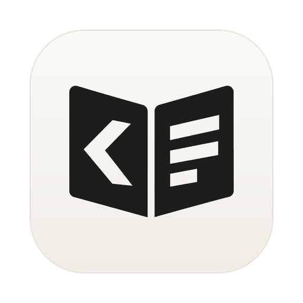
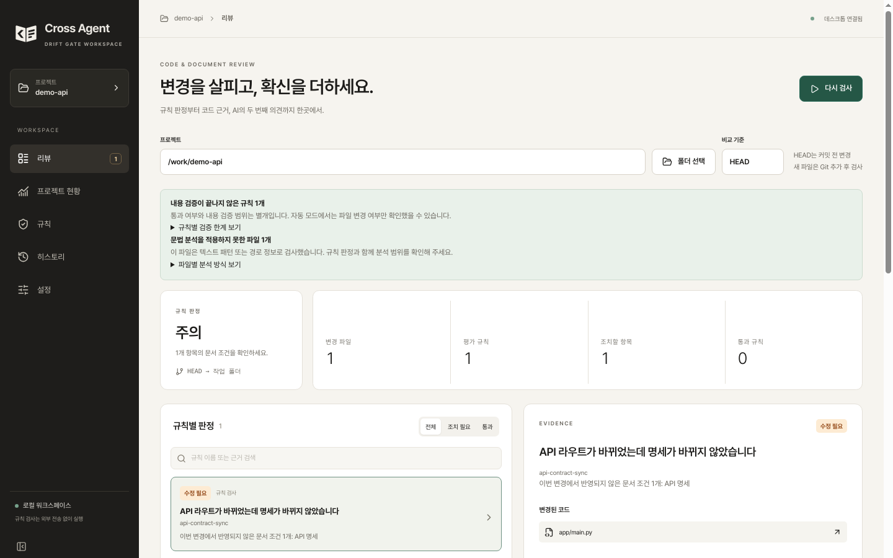
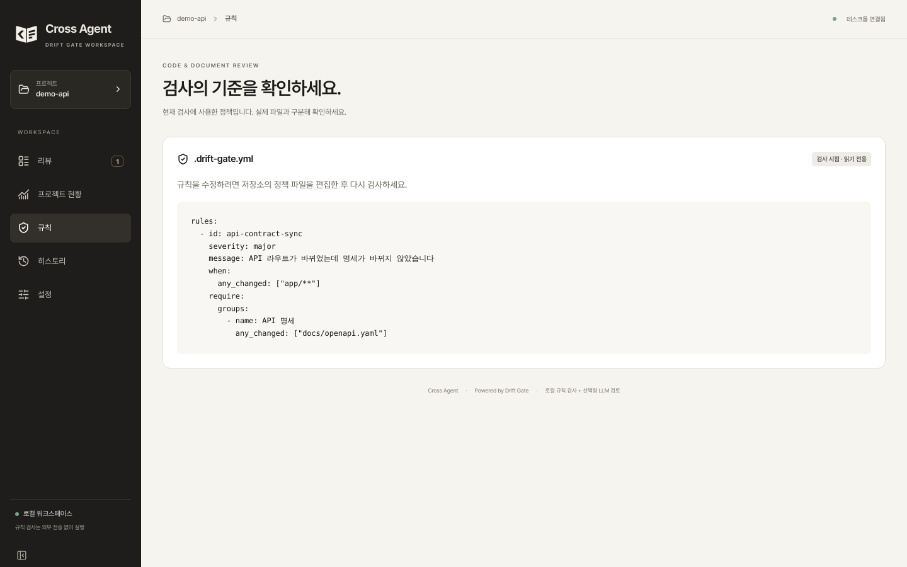
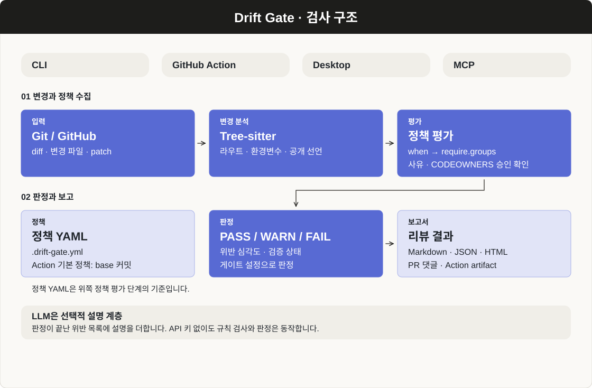
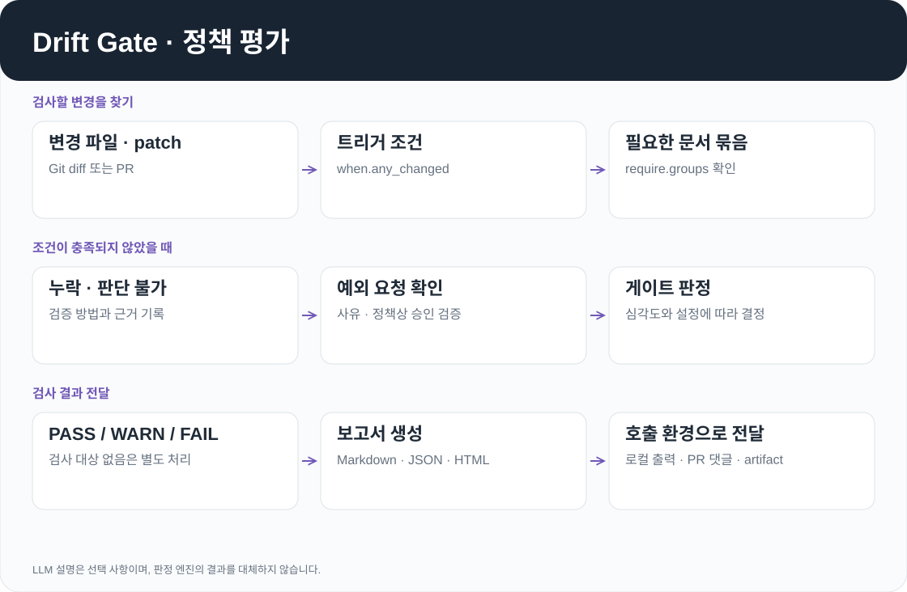
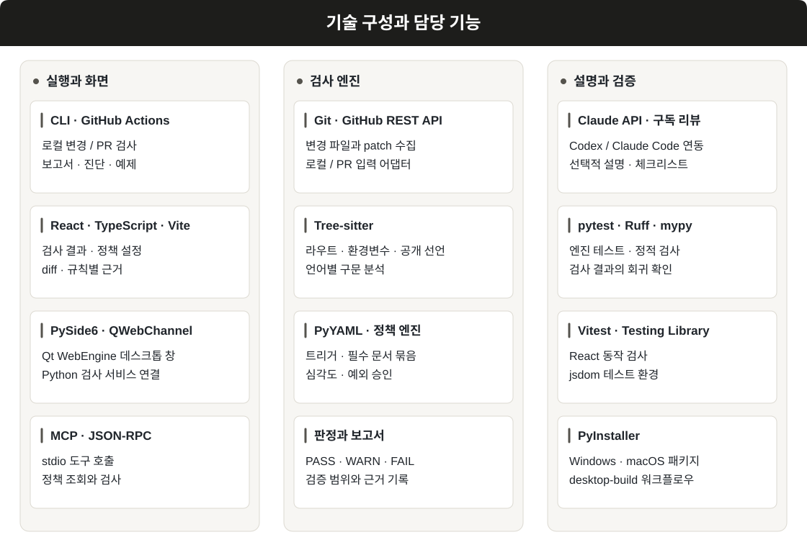

<p align="center">
  
</p>

<h1 align="center">Drift Gate</h1>

<p align="center">
  <a href="https://github.com/cres17/pr-convention-checker/actions/workflows/ci.yml?query=branch%3Amain"></a>
  <a href="LICENSE"></a>
</p>

<p align="center">
  
  
  
  
  <br>
  
  
  
  <br>
  
  
  
</p>

코드 변경에 필요한 문서 수정이 빠졌는지 검사합니다. API 경로를 바꿨는데 명세에 이전 주소가 남아 있거나, 환경변수를 추가했는데 `.env.example`에는 없는 경우를 PR에서 확인하기 위해 만들었습니다.

팀의 규칙은 `.drift-gate.yml`에 작성합니다. 같은 엔진을 로컬 CLI, GitHub Action, 데스크톱 앱과 MCP 서버에서 사용할 수 있습니다.

[화면](#화면) · [검사 과정](#검사-과정) · [판정](#판정) · [시작하기](#시작하기) · [GitHub Action](#github-action) · [개발](#개발)

## 화면

<div align="center">

| 검사 결과 | 정책 설정 |
|:---:|:---:|
|  |  |

</div>

FastAPI 라우트를 추가하고 `docs/openapi.yaml`은 수정하지 않은 예제 저장소를 검사한 화면입니다.

## 검사 과정


<p align="center">
  
</p>

로컬에서는 Git diff를 읽고, Action에서는 GitHub API로 PR의 변경 파일과 patch를 가져옵니다. Tree-sitter가 코드 변경에서 라우트, 환경변수 접근과 공개 선언을 추출하면 정책 엔진이 필요한 문서의 변경 여부를 평가합니다.

<div align="center">

| 변경 | 확인하는 내용 |
|:---:|:---:|
| API 메서드·경로 | 코드에서 추가·삭제된 경로와 명세 diff 비교 |
| 환경변수 | 새 키의 누락과 삭제된 키의 잔존 여부 |
| DB·인프라·CI·인증 | 정책에서 지정한 문서가 함께 수정되었는지 |

</div>

문서 경로의 동반 변경만 확인한 경우에는 `unverified`를 표시합니다. 파싱이 실패하거나 diff에 문맥이 부족해 휴리스틱을 사용한 경우도 보고서에 남깁니다.

<p align="center">
  
</p>

규칙의 `when.any_changed`에 해당하는 코드가 바뀌면 `require.groups`를 평가합니다. 필요한 묶음을 모두 만족해야 규칙이 통과합니다. 문서·테스트만 바뀌었고 명시적인 트리거도 없으면 평가를 생략할 수 있습니다.

## 판정


최종 결과는 위반의 심각도와 게이트 설정으로 결정합니다. LLM은 이 판정에 참여하지 않습니다.

<div align="center">

| 조건 | 기본 동작 |
|:---:|:---:|
| BLOCKER가 있고 `fail_on_blocker`가 켜짐 | FAIL |
| MAJOR가 `fail_on_major_count` 이상, 기본 2건 | FAIL |
| 요구 조건을 판단하지 못했거나 일부만 검증 | `on_unverified`에 따라 FAIL 또는 WARN, 기본 FAIL |
| 그 외 MAJOR·MINOR 또는 advisory가 남음 | WARN |
| 위 항목에 해당하지 않음 | PASS |

</div>

경로 변경만 확인했다는 `unverified` 표시와, 요구 조건 자체를 판단하지 못한 상태는 다릅니다. 전자는 경로 기준 검사의 범위를 나타내며 위 표의 검증 불가 분기에 포함되지 않습니다.

### 예외 승인

PR 본문에 `drift-ignore: <rule-id> 사유`를 적어 예외를 요청할 수 있습니다. BLOCKER·MAJOR 규칙은 사유가 필요합니다. 정책에서 승인을 요구하면 base 브랜치의 CODEOWNERS와 현재 head 커밋에 대한 리뷰 승인을 대조합니다. 승인자는 작성자 외의 쓰기 권한 보유자여야 하며, 이름만 본문에 적는 것으로 승인 처리하지 않습니다.

Action은 기본적으로 base 커밋의 정책을 읽습니다. 검사받는 PR에서 정책을 바꿔 자신의 위반을 없애는 일을 방지하기 위해서입니다.

### 선택적 LLM 설명

Claude API 키가 있으면 판정이 끝난 위반 목록에 체크리스트와 설명을 덧붙입니다. 키가 없어도 검사는 동작합니다. fork PR에서는 이 호출과 결과 댓글 게시를 생략합니다.

데스크톱의 구독 검토는 로그인한 Codex CLI 또는 Claude Code를 하위 프로세스로 실행합니다. 전송할 내용은 실행 전에 확인할 수 있으며 검토 도중 중지할 수 있습니다.

## 시작하기

Python 3.10 이상에서 저장소를 내려받은 뒤 실행합니다.

```bash
pip install -e .
drift-gate init --preset api
drift-gate check --base HEAD
```

`check --base HEAD`는 작업 트리의 변경을 검사합니다. 예를 들어 FastAPI 코드를 수정할 때 OpenAPI 문서도 바뀌어야 한다면 다음처럼 작성합니다.

```yaml
rules:
  - id: api-contract-sync
    severity: major
    message: API 라우트가 바뀌었는데 명세가 바뀌지 않았습니다
    when:
      any_changed: ["app/**"]
    require:
      groups:
        - name: API 명세
          any_changed: ["docs/openapi.yaml"]
```

위 정책은 문서 경로의 변경을 요구하는 예제입니다. 명세를 고치지 않으면 MAJOR 1건으로 기본 판정은 WARN, 종료 코드는 0입니다. 명세도 수정하면 PASS가 되지만 내용까지 대조한 검사는 아니므로 `unverified`가 표시됩니다.

초기 정책은 `auto`, `api`, `auth`, `ci`, `db`, `env`, `focused-python`, `fullstack` 프리셋에서 고를 수 있습니다. 프레임워크별 예시는 [examples](examples)에 있습니다.

## GitHub Action


루트의 `action.yml`은 composite action입니다. PR 이벤트에서 실행하면 변경과 정책을 조회하고 결과를 댓글 및 보고서로 남깁니다. 같은 마커의 댓글을 갱신하므로 실행할 때마다 요약 댓글을 추가하지 않습니다.

<div align="center">

| 입력 | 기본값 | 용도 |
|:---:|:---:|:---:|
| `policy_file` | `.drift-gate.yml` | 정책 경로 |
| `policy_source` | `base` | base 커밋 또는 체크아웃한 workspace의 정책 |
| `post_comment` | `true` | PR 결과 댓글 |
| `fail_on_blocker` | `true` | fail 판정을 job 실패로 반영 |
| `upload_report_artifact` | `true` | Markdown·JSON·HTML 보고서 보관 |
| `anthropic_api_key` | 없음 | 선택적 설명 생성 |

</div>

출력은 `result`, `blocker_count`, `major_count`, `violation_count`, `policy_origin`, `comment_url`입니다. `result`는 `pass / warn / fail / skip` 중 하나입니다.

## 코드 구성


`drift_gate/core`에는 외부 I/O 없이 실행되는 정책 모델, 분류, 판정과 예외 검증을 둡니다. Git, GitHub, AST, CLI와 MCP 연결은 `adapters`가 맡고, 출력 형식은 `reporters`에서 처리합니다. 실행 환경이 달라도 같은 규칙 엔진을 사용하기 위한 구분입니다.

데스크톱은 PySide6의 Qt WebEngine에 React 화면을 띄우고 QWebChannel로 Python 검사 서비스와 연결합니다. React 소스는 `desktop-ui/`, 배포용 웹 빌드 결과는 `drift_gate/desktop/web/`에 있습니다.

AST 분석은 Python과 TypeScript/JavaScript의 라우트·환경변수를 추출하며 Go·Java·Kotlin·Ruby에서는 공개 함수와 타입 선언을 추출합니다. 배포하는 Tree-sitter 파서는 `parser_hashes.json`과 해시를 대조합니다.

## 기술별 역할

<p align="center">
  
</p>

### 변경 수집과 정책 평가

Python 검사 엔진을 CLI·Action·데스크톱·MCP에서 함께 호출합니다. 실행 환경마다 변경 내용을 가져오는 방법은 달라도 정책을 해석하고 위반을 결정하는 코드는 공유합니다.

<div align="center">

| 기술 | 검사에서 하는 일 | 코드 |
|:---:|:---:|:---:|
| Git | 로컬 base·head 사이의 변경 파일과 diff 수집 | `drift_gate/adapters/git` |
| GitHub REST API | PR 변경 파일과 patch 수집 | `drift_gate/adapters/github` |
| PyYAML | 정책 파일을 읽고 트리거·필수 문서 묶음·심각도 구성 | `drift_gate/core/policy` |
| Tree-sitter · language pack | 구문 트리에서 라우트, 환경변수 접근, 공개 선언 추출 | `drift_gate/adapters/ast` |
| 정책 엔진 | 변경 신호와 문서 변경을 대조하고 PASS·WARN·FAIL 판정 | `drift_gate/core` |
| GitHub Actions | PR 검사와 보고서 보관, 데스크톱 빌드 실행 | `.github/workflows` |

</div>

Python·TypeScript/JavaScript에서는 라우트와 환경변수 사용을 추출하고 Go·Java·Kotlin·Ruby에서는 공개 함수와 타입 선언을 추출합니다. 언어별 추출 범위가 같지 않으며, 구문 분석 실패와 휴리스틱 사용 여부를 보고서에 남깁니다.

### CLI·데스크톱·MCP

CLI는 `check`로 검사하고 `report`, `explain`, `doctor`, `demo`, `holdout` 등의 명령으로 결과 조회와 진단을 수행합니다. MCP는 별도 외부 SDK 없이 JSON-RPC를 stdio로 주고받으며, MCP 클라이언트에서 정책 조회와 검사를 호출할 수 있게 합니다.

데스크톱 앱은 PySide6의 Qt WebEngine 안에 React 화면을 띄웁니다. React가 직접 Python 모듈을 호출하는 대신 QWebChannel을 통해 검사 서비스와 연결됩니다. 저장소 선택, 규칙별 근거와 diff 확인, 보고서 저장을 이 창에서 처리합니다.

<div align="center">

| 구성 | 역할 |
|:---:|:---:|
| React 19 · TypeScript · Vite | 검사 결과와 정책 설정 화면, 프런트엔드 타입 검사·빌드 |
| PySide6 · Qt WebEngine · QWebChannel | 데스크톱 창과 웹 화면, Python 서비스 사이의 연결 |
| @pierre/diffs | 변경 코드의 diff 표시 |
| Radix UI · Tailwind CSS · Lucide | 접기·구분선 등 UI 요소, 스타일, 아이콘 |
| Zod | 프런트엔드 데이터 검증 |
| PyInstaller | Windows·macOS 배포 패키지 생성 |

</div>

### 선택적 리뷰와 검증

Claude API는 검사 결과의 설명과 체크리스트를 보강합니다. 데스크톱의 구독 검토는 로그인된 Codex CLI 또는 Claude Code를 하위 프로세스로 실행합니다. 전송 내용을 먼저 보여 주고 실행 중 중지할 수 있습니다. 이 리뷰 결과가 정책 엔진의 판정을 대신하지는 않습니다.

Python 쪽은 pytest·pytest-cov·Ruff·mypy로 검사하고, React 쪽은 Vitest·Testing Library·jsdom으로 확인합니다. FastAPI·Pydantic·jsonschema는 선택 설치하는 oracle 검증 환경의 의존성입니다. 기본 검사 엔진을 웹 서버로 실행하기 위해 반드시 설치하는 항목은 아닙니다.

시작점은 [CLI 어댑터](drift_gate/adapters/cli), [MCP 서버](drift_gate/adapters/mcp/server.py), [데스크톱 앱](drift_gate/desktop/web_app.py), [웹 UI](desktop-ui)입니다.

## 개발

```bash
pip install -e ".[dev]"
ruff check drift_gate/ --select=E9,F
mypy drift_gate/core --ignore-missing-imports
pytest drift_gate/tests
drift-gate demo
```

CI는 Ubuntu·Windows·macOS와 Python 3.10·3.11·3.12의 9개 조합에서 테스트합니다. 정적 검사, 합성 평가셋, 파서 해시 확인은 별도 작업으로 실행합니다. 데스크톱 배포는 PyInstaller로 Windows와 macOS 패키지를 만듭니다.

`demo`는 합성 21개 사례에서 경로 기준 검사와 patch 분석을 비교합니다. 실제 조직의 PR 성능을 측정한 수치가 아니며, 평가 원자료와 검증 기록은 [docs/assessment](docs/assessment)에 있습니다.
